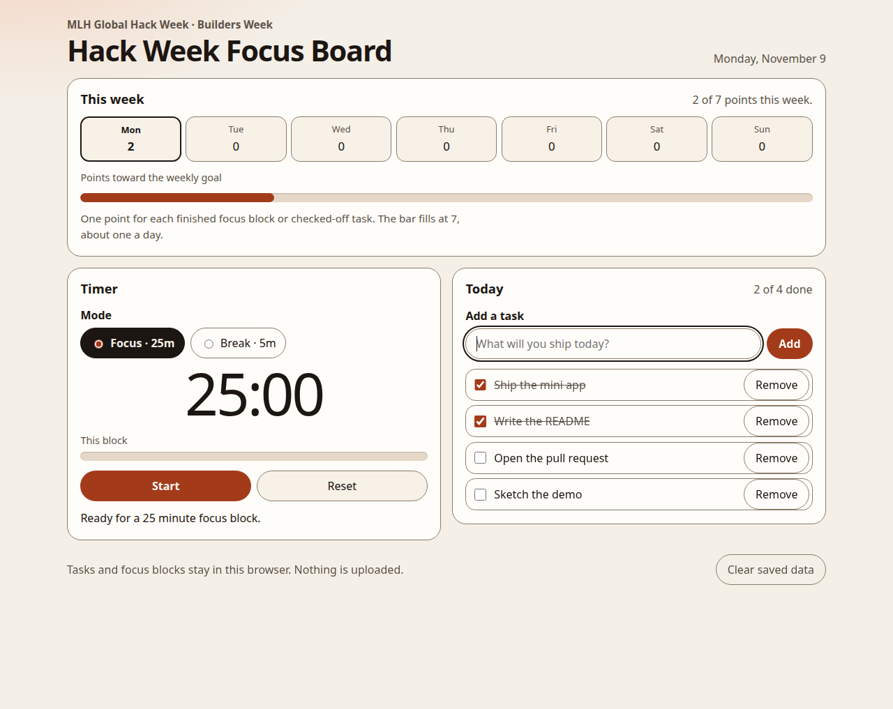

# Hack Week Focus Board

A single-page focus board for a hackathon week. It puts a Pomodoro timer, today's task list, and a weekly progress bar on one screen so you can keep a build moving without another tab.

Built with Cursor for MLH Global Hack Week: Builders Week.

## Features

- **Pomodoro timer.** 25-minute focus blocks and 5-minute breaks. Start, pause, and reset. The clock is based on the end time, so it stays accurate if the tab is in the background. A finished focus block scores a point and lines up the next break.
- **Daily task list.** Add a task, check it off, or remove it. The list is stored in `localStorage` and is kept per calendar day.
- **Week progress.** Monday–Sunday counts. Each finished focus block and each checked-off task is one point. The bar fills at 7, about one a day.
- **Stays on this machine.** Nothing is uploaded. Clear saved data from the bottom of the page.

## How to run

No build step and no dependencies.

- Open `index.html` in a browser.
- Or, from this folder: `python3 -m http.server` and visit `http://localhost:8000`.
- For GitHub Pages, publish the branch from the repository root. The site is the `index.html` file in that root.

## How Cursor helped

Cursor drafted the page, the timer state (including finishing a block after the tab was closed), and the week-point math in plain HTML, CSS, and JavaScript. It also wired accessible names, a native progress bar, light and dark colors, and this README, then checked the timer, the checklist, and the progress bar in a browser.
